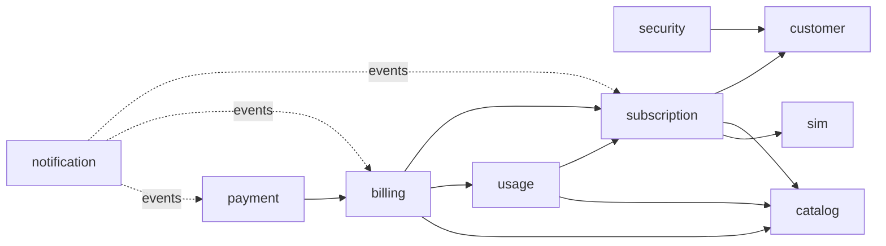
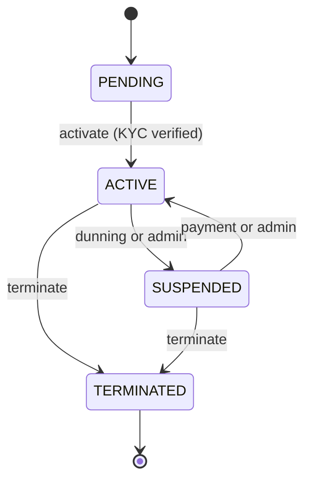
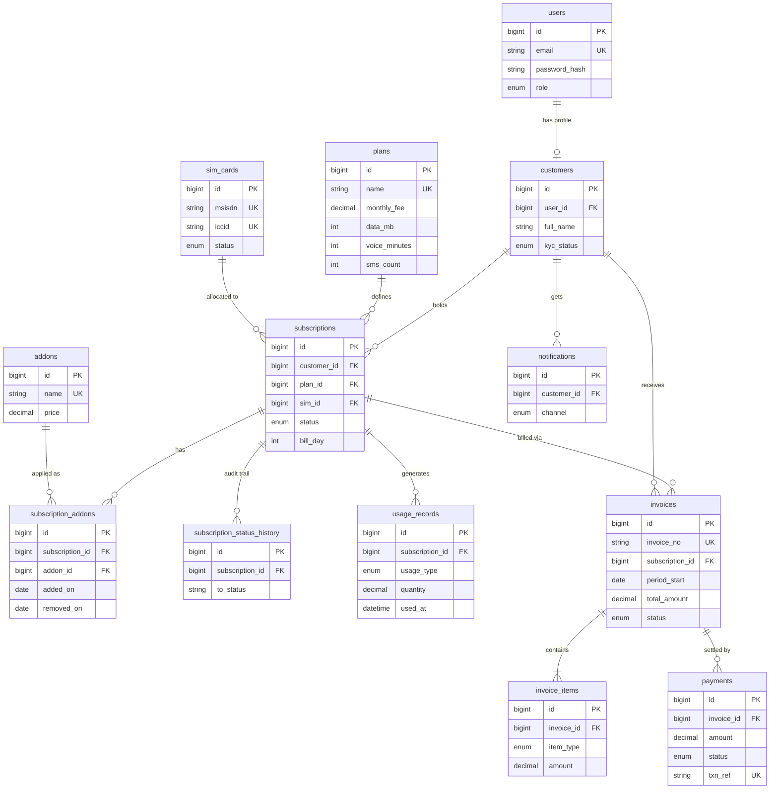

# Telecom BSS: Subscription Lifecycle & Billing Platform

Architecture, domain model, flows, database, APIs and interview notes for a postpaid mobile **Business Support System (BSS)**: onboarding and KYC, plan catalog, SIM inventory, subscription lifecycle, usage rating, billing and (next) payments and dunning.

**Stack:** Java 21, Spring Boot 3.2, Maven, MySQL 8, Flyway, JPA/Hibernate, Spring Security + JJWT 0.12.3, Lombok, ModelMapper, SpringDoc OpenAPI, GitHub Actions. Docker and React are next.

> Personal portfolio project built on fake data. It is not client work.

---

## 1. Status and roadmap

| Phase | Scope | Status |
|---|---|---|
| Day 1 | Project setup, Flyway schema + seed, catalog slice, global exceptions, AOP logging | Done |
| Day 1 | GitHub repo, CI (build + MySQL container), AI PR review, merge gate, protected `main` | Done |
| Day 2 | Auth (JWT, roles), customer profile and KYC | Done |
| Day 3 | SIM inventory, subscription provisioning | Done |
| Day 4 | Usage records (CDR), rating engine, add-on management | Done |
| Day 5 | Billing engine, invoices, invoice items, 18% GST | Done |
| Next | Payments (mock gateway), dunning, notifications, integration tests | Planned |
| Next | Docker: Dockerfile, Compose (app + MySQL) | Planned |
| Next | React: customer portal, then admin/CSR console, UI container | Planned |
| Phase 2 | Microservices split, SonarQube + coverage, Jenkins (learning) | Planned |

> Sections 5.4 to 5.6 describe the Day 4 and Day 5 rules as designed. Confirm endpoint names against Swagger (`/swagger-ui.html`) and edit anything that differs.

---

## 2. Architecture

### 2.1 Modular monolith first
One deployable Spring Boot application, split into domain packages that can later become services.

Root package: `com.yojit.bss`

```
com.yojit.bss
 ├── common        (global exceptions, AOP logging, config)
 ├── security      (Spring Security, JWT filter and service, User entity, Role enum)
 ├── customer      (customer profile, KYC)
 ├── catalog       (plans, add-ons)
 ├── sim           (SIM inventory and status)
 ├── subscription  (subscription provisioning and lifecycle)
 ├── usage         (usage records / CDRs, rating)
 ├── billing       (bill run, invoices, invoice items)
 ├── payment       (payments)                    planned
 └── notification  (email / SMS, mocked)         planned
```

Each module has `controller / service / repository / entity / dto`.

### 2.2 Intended module dependencies



Arrows go one way. Nothing depends on `billing` or `payment` except `payment` on `billing`, and `notification` only listens.

### 2.3 Boundary rules
1. A module owns its tables and repositories. Other modules call its **service**, not its repository.
2. Entities never leave the service layer. Controllers and cross-module calls use **DTOs**.
3. Cross-module references should be ids (`customerId`, `planId`, `simId`). The current `Subscription` uses bounded JPA associations for transactional simplicity. This is a deliberate trade-off, listed in section 9, and it is the first thing to change before a microservice split.
4. Reactions between modules (invoice generated, payment failed) go through **events**, so the listener can later become a message consumer.
5. Validation uses Jakarta Bean Validation (`@Valid`). Errors are handled centrally by `@RestControllerAdvice`.
6. Cross-cutting logging is done by `LoggingAspect` (AOP). It never logs passwords, tokens or auth request bodies.

---

## 3. Domain and business flow

### 3.1 End-to-end flow (order to cash)
1. A user **registers** and **logs in**, receiving a stateless JWT.
2. The user creates a **customer profile** with KYC details. KYC starts as `PENDING`. An admin or CSR sets `VERIFIED` or `REJECTED`.
3. Admins load **SIM cards** into inventory as `AVAILABLE`.
4. The customer picks a **plan** and a SIM. In one transaction the SIM becomes `ASSIGNED` and a subscription is created with `bill_day` and `activated_at`.
5. **Usage** (voice minutes, SMS, data MB) is ingested as usage records (CDRs) per subscription.
6. The **rating engine** compares usage with the plan allowance (plus add-ons) and prices the overage.
7. The **billing job** runs per cycle: plan fee + add-ons + overage + 18% GST becomes an **invoice** with itemized lines.
8. The customer **pays** (planned). Unpaid invoices become `OVERDUE` and the subscription is **suspended** (planned, dunning).

### 3.2 Subscription state machine



The schema supports all four states. The current provisioning flow creates the subscription directly as `ACTIVE`. The full state machine with history is on the roadmap (section 9).

### 3.3 Telecom vocabulary
| Term | Meaning |
|---|---|
| BSS / OSS | Business Support System (customers, products, billing) vs Operations Support System (network operations) |
| MSISDN | The phone number |
| ICCID | The SIM card serial number |
| Postpaid / prepaid | Billed after use each cycle / paid before use |
| CDR | Call Detail Record: one usage event |
| Rating | Turning usage into a charge using the tariff |
| Overage | Usage beyond the plan allowance |
| Bill cycle / bill day | The recurring billing window and the day it starts |
| Dunning | The process of chasing unpaid bills (reminders, suspension) |
| Proration | Charging part of a period when a plan changes mid-cycle (not implemented) |
| KYC | Know Your Customer: identity verification before service |

---

## 4. Data model

### 4.1 Relationships
- `users` 1:1 `customers`
- `customers` 1:N `subscriptions`; `plans` 1:N `subscriptions`; `sim_cards` 1:1 `subscriptions` (at a time)
- `subscriptions` 1:N `subscription_addons`, `subscription_status_history`, `usage_records`, `invoices`
- `invoices` 1:N `invoice_items` and `payments`
- `customers` 1:N `notifications`



### 4.2 Database rules
- Schema is owned by **Flyway** (`db/migration`). `V1` schema, `V2` seed data, `V3` dev-only passwords for seed users. Later versions add changes.
- **Applied migrations are never edited.** Flyway stores a checksum and refuses to start on a mismatch. Fixes go in a new version.
- `spring.jpa.hibernate.ddl-auto=validate`: Hibernate checks entities against the schema and never alters it.
- Money is `DECIMAL(10,2)` in MySQL and `BigDecimal` in Java.
- `invoices` has a unique key `(subscription_id, period_start)`. It makes the bill run **idempotent**.
- `plans.monthly_fee`, `data_mb`, `voice_minutes`, `sms_count` and the three overage rates drive rating.

### 4.3 JPA mapping notes
| Column | Mapping | Why |
|---|---|---|
| `users.role`, `customers.kyc_status` | Java enums with `@Enumerated(EnumType.STRING)` | ORDINAL breaks if the order changes. STRING is readable and stable |
| `subscriptions.bill_day` | `Integer` with `columnDefinition = "TINYINT"` | With `validate`, Hibernate expects `INTEGER` for `Integer`. The explicit definition matches the MySQL `TINYINT` |
| `sim_cards.status`, `subscriptions.status` | Currently `String` with an `ENUM(...)` `columnDefinition` | Works, but loses type safety. Planned change to Java enums (section 9) |

---

## 5. Module specifications

### 5.1 `security` (auth)
- `POST /api/auth/register`: validated email and password, role forced to `CUSTOMER`, BCrypt hash. Duplicate email returns 409.
- `POST /api/auth/login`: returns a JWT (subject = email, claim = role, expiry 1 hour).
- `JwtAuthenticationFilter` (`OncePerRequestFilter`) validates the token and sets the `SecurityContext`.
- Roles: `ADMIN`, `CSR`, `CUSTOMER`. Method security with `@PreAuthorize`.
- Stateless, CSRF disabled. 401 and 403 return the same JSON `ErrorResponse` as other errors.
- Public paths: `/api/auth/**`, `/swagger-ui/**`, `/v3/api-docs/**`, `/actuator/health`, `GET /api/plans/**`.

### 5.2 `customer`
- `POST /api/customers/me`, `GET /api/customers/me`: the customer is identified from the JWT, never from the request body.
- One profile per user (`customers.user_id` is unique).
- KYC status starts `PENDING`. Verification is an ADMIN/CSR action.

### 5.3 `catalog` and `sim`
- **Plans:** `GET /api/plans` (active only), `GET /api/plans/{id}`, `POST /api/plans` (admin).
- **SIM:** entity `SimCard` (`msisdn` unique, `iccid` unique, status `AVAILABLE`, `ASSIGNED`, `BLOCKED`). `SimCardService.addSimCard` checks uniqueness first. `POST /api/sims`, `GET /api/sims`.

### 5.4 `subscription`
Entity `Subscription`: `customer`, `plan`, `simCard` (lazy associations), `status`, `billDay`, `activatedAt`, `terminatedAt`, `createdAt`.

**Provisioning (`createSubscription`, one `@Transactional` method):**
1. Resolve the customer from the JWT identity. Missing profile gives `ResourceNotFoundException`.
2. Load the plan.
3. Load the SIM and require `AVAILABLE`.
4. Set the SIM to `ASSIGNED`.
5. Create the subscription: status `ACTIVE`, `billDay = today's day of month`, `activatedAt = now`.
6. Map to `SubscriptionResponse`.

If any step fails, the whole transaction rolls back, so no SIM is left assigned without a subscription.

Endpoints: `POST /api/subscriptions`, `GET /api/subscriptions/me`.

> `bill_day` is meant to be 1 to 28 so every month has the day. If it is set from today's date, cap it at 28.

### 5.5 `usage` (CDR ingestion and rating)
- `usage_records`: one row per usage event: subscription, type (`VOICE` minutes, `SMS` count, `DATA` MB), quantity, timestamp.
- **Rating** compares cycle usage with the allowance and prices only the excess:

```
allowance(type) = plan allowance(type) + sum of active add-on allowance(type)
overage(type)   = max(0, usage(type) - allowance(type))
overage charge  = overage(type) * plan overage rate(type)
```

- **Add-ons:** `subscription_addons` links a subscription to an add-on with `added_on` and `removed_on`. An add-on adds its price to the bill and extends the allowance while it is active.
- A usage summary (used vs allowance for the current cycle) feeds the UI progress bars.

### 5.6 `billing`
- A bill run (scheduled job and an admin trigger) bills each `ACTIVE` subscription whose cycle has ended.
- **Cycle:** from `bill_day` to the day before the next `bill_day`.
- **Invoice:**

```
subtotal = plan fee + add-on charges + overage charges
GST      = subtotal * 18%
total    = subtotal + GST         (BigDecimal, scale 2, RoundingMode.HALF_UP)
```

- Invoice items are written per line: `PLAN`, `ADDON`, `OVERAGE`, `TAX`. Due date is 14 days after issue.
- **Idempotent:** one invoice per `(subscription_id, period_start)`. A second run never double-bills.

**Worked example** (Standard plan: 499, 20480 MB, overage 0.02 per MB; add-on Extra 5GB: 99, +5120 MB; data used 26000 MB):

| Step | Value |
|---|---|
| Allowance | 20480 + 5120 = 25600 MB |
| Overage | 26000 - 25600 = 400 MB |
| Overage charge | 400 x 0.02 = 8.00 |
| Subtotal | 499 + 99 + 8 = 606.00 |
| GST 18% | 109.08 |
| **Total** | **715.08** |

> GST here is simplified to a flat 18%. Real Indian GST splits into CGST + SGST (intra-state) or IGST (inter-state).

### 5.7 `payment`, dunning, `notification` (planned)
- **Payment:** `POST /api/payments` with a mock gateway. Success sets the invoice `PAID`. Failure is recorded and the invoice stays open. A paid invoice cannot be paid twice.
- **Dunning:** a daily job marks invoices `OVERDUE` after the due date, then suspends the subscription after a grace period. A successful payment reactivates it.
- **Notification:** `@TransactionalEventListener(AFTER_COMMIT)` listeners write rows to `notifications` (channel mocked).

---

## 6. API directory

| Module | Method | Endpoint | Access |
|---|---|---|---|
| Auth | POST | `/api/auth/register` | Public |
| Auth | POST | `/api/auth/login` | Public |
| Catalog | GET | `/api/plans`, `/api/plans/{id}` | Public |
| Catalog | POST | `/api/plans` | ADMIN |
| Customer | POST / GET | `/api/customers/me` | Authenticated |
| SIM | POST / GET | `/api/sims` | Authenticated (restrict to ADMIN/CSR) |
| Subscription | POST | `/api/subscriptions` | Authenticated |
| Subscription | GET | `/api/subscriptions/me` | Authenticated |
| Usage | POST | usage ingestion / simulation | ADMIN (confirm in Swagger) |
| Usage | GET | usage summary for the current customer | Authenticated (confirm) |
| Add-ons | POST / DELETE | add-on attach / detach on a subscription | Owner (confirm) |
| Billing | POST | bill run trigger | ADMIN (confirm) |
| Invoices | GET | list and detail | Owner, ADMIN, CSR (confirm) |
| Payments | POST | pay an invoice | Owner (planned) |

---

## 7. Security, configuration and secrets

- Stateless JWT (HS256), 1 hour expiry, BCrypt password hashing. Hashes and tokens are never returned or logged.
- The customer id comes from the token, never from the body or path, which prevents IDOR.
- **Secrets come from the environment**, never from the repo (the repo is public):
  - `DB_PASSWORD` and `JWT_SECRET` have **no default**, so the app refuses to start without them.
  - Locally: git-ignored `application-local.properties` (profile `local`) or environment variables.
  - CI uses throwaway values and a MySQL service container.
- Rotate any secret that was ever committed. Deleting it later does not remove it from history.

---

## 8. Engineering workflow

- `main` is protected by a ruleset: pull requests only, squash merge, required checks `build` and `ai-gate`.
- Each PR runs: Maven build and tests against a MySQL container, an AI review (Gemini through PR-Agent), and a gate job that fails on a "Possible security concern" label.
- The AI reviewer has already caught a real hardcoded secret and weakly typed enum fields in this project.
- Branch per feature, small commits, conventional messages (`feat:`, `fix:`, `chore:`, `docs:`).
- Dependabot opens weekly update PRs for Maven and GitHub Actions.
- Secret scanning and push protection are enabled on the repo.

---

## 9. Known gaps and planned improvements

Listing these honestly is part of the design. Each is a good interview answer to "what would you improve?".

| Gap | Impact | Planned fix |
|---|---|---|
| `SimCard.status` and `Subscription.status` are `String` | No compile-time safety, typos possible | Java enums with `@Enumerated(EnumType.STRING)` |
| Subscription is created directly `ACTIVE` | Skips `PENDING`, and does not require `KYC = VERIFIED` | State machine in the enum (`canTransitionTo`), activation requires verified KYC |
| No `subscription_status_history` writes | No audit trail of state changes | Write a row on every transition, in the same transaction |
| SIM claim relies on a status check | Two concurrent requests can read `AVAILABLE` at the same time | Pessimistic lock (`@Lock(PESSIMISTIC_WRITE)`) or optimistic `@Version`, plus a unique constraint on the active SIM assignment |
| `IllegalArgumentException` for business errors | Wrong semantics and status code | Dedicated `BusinessRuleException` mapped to 400/409 |
| SIM endpoints open to any authenticated user | Customers can list inventory | `@PreAuthorize` for ADMIN/CSR |
| JPA associations across modules (`Subscription` to `Customer`, `Plan`, `SimCard`) | Tight coupling for a microservice split | Replace with ids and service calls |
| No events yet | Modules would call each other directly for notifications | `ApplicationEventPublisher` and `@TransactionalEventListener(AFTER_COMMIT)` |
| Flat 18% GST | Not how real GST splits | CGST/SGST/IGST based on customer state |
| No proration | Mid-cycle plan changes are not handled | Prorate by days remaining in the cycle |
| Scheduler runs on every instance | Double bill runs if the app is scaled out | Idempotent key (already there) plus ShedLock or a single scheduler service |

---

## 10. Key decisions and rationale

| Decision | Rationale |
|---|---|
| Modular monolith first | Learn the domain without distributed-system pain. Packages keep boundaries clear for a later split |
| Flyway, never `ddl-auto=update` | Versioned, reviewable, repeatable schema changes |
| Never edit an applied migration | Flyway checksums it. Add a new version instead |
| `ddl-auto=validate` | Entities must match the real schema. Hibernate never changes it |
| DTOs, never entities, in the API | No schema leaks, no lazy-loading JSON errors, a stable contract |
| `BigDecimal` for money | Floating point cannot represent 0.1 exactly |
| Stateless JWT | No server session, scales horizontally, suits a service split |
| `@Transactional` provisioning | SIM assignment and subscription commit or roll back together |
| Idempotent invoice key | A re-run of the bill run can never double-bill |
| Secrets from the environment, no defaults | 12-factor config, fail fast, nothing secret in a public repo |
| Customer id from the token | Prevents IDOR |
| Protected `main` + CI gate + AI review | Nothing reaches `main` without a green build and a review |

---

## 11. Interview questions and answers

### A. Architecture and design

**Why a modular monolith first, and how would you split it?**
It is simpler to build, debug and deploy while the domain is still being learned. Clear packages with one-way dependencies make the split a refactor, not a rewrite. To split: replace cross-module JPA associations with ids, give each service its own database, replace in-process calls with REST/Feign and in-process events with Kafka or RabbitMQ, and add a gateway and service discovery.

**Which modules would become microservices first, and why?**
Customer, catalog, subscription, billing (with payment) and notification. Billing is the best candidate to extract early because it is a batch workload with a different scaling profile. Usage ingestion is also a candidate because it is write-heavy.

**What are the risks of splitting too early?**
Network failures, distributed transactions, data consistency, harder debugging and operational overhead, without having learned where the real boundaries are.

**How would you keep data consistent across services after the split?**
Avoid distributed transactions. Use events with the **outbox pattern** for reliable publishing, and **sagas** (choreography or orchestration) with compensating actions, for example cancelling a subscription if payment setup fails.

**What is the difference between BSS and OSS?**
BSS handles the business side (customers, orders, billing). OSS handles the network side (provisioning, fault management, inventory).

**Why DTOs instead of entities in the API?**
They hide internal fields, decouple the API from the schema, avoid lazy-loading and recursion issues in JSON, and let you change the database without breaking clients.

**What are the responsibilities of controller, service and repository?**
Controller: HTTP, validation, status codes. Service: business rules and transactions. Repository: data access only.

### B. Spring, JPA and transactions

**How do you guarantee atomicity when activating a subscription and assigning a SIM?**
`createSubscription` is `@Transactional`. Reading the SIM, checking it is `AVAILABLE`, setting it `ASSIGNED` and inserting the subscription happen in one database transaction. If anything fails, everything rolls back, so there are no orphaned SIM assignments.

**How does `@Transactional` work, and when does it not?**
Spring wraps the bean in a proxy that opens the transaction before the method and commits or rolls back after. It does not apply on self-invocation (a method calling another method of the same class), on private methods, or on objects not managed by Spring.

**Which exceptions roll back by default?**
Unchecked exceptions (`RuntimeException`) and errors. Checked exceptions do not, unless you set `rollbackFor`.

**How does the system prevent two subscriptions from claiming the same SIM?**
Today: a service-level check that the SIM is `AVAILABLE`, inside a transaction, plus unique `msisdn` and `iccid`. This alone has a race window, because two transactions can both read `AVAILABLE`. The fix is a pessimistic write lock on the SIM row (`SELECT ... FOR UPDATE`) or optimistic locking with `@Version`, plus a database constraint so the same SIM cannot be actively assigned twice.

**Pessimistic vs optimistic locking?**
Pessimistic locks the row up front and suits high contention (a scarce SIM). Optimistic uses a version column and fails on conflict, which suits low contention and avoids holding locks.

**Why `FetchType.LAZY`, and what is the N+1 problem?**
Lazy loading fetches associations only when used. N+1 happens when you load N parents and then trigger one query per parent for an association. Fix with `join fetch`, `@EntityGraph` or DTO projections.

**Why is `open-in-view` set to false?**
It stops the persistence context staying open through the web layer, which hides lazy-loading queries and keeps database work inside the service layer. The cost is that lazy fields accessed outside a transaction throw `LazyInitializationException`, so map to DTOs inside the service.

**Why was `columnDefinition = "TINYINT"` needed for `bill_day`?**
With `ddl-auto=validate`, Hibernate compares the entity with the schema. A Java `Integer` maps to `INTEGER`, but Flyway created a `TINYINT`, so validation failed. The explicit definition tells Hibernate the mismatch is intentional.

**Why `@Enumerated(EnumType.STRING)`?**
ORDINAL stores the position, so reordering or inserting an enum value silently corrupts data. STRING is stable and readable.

**Why does Flyway refuse to start if you edit an old migration?**
It stores a checksum of every applied migration in `flyway_schema_history` and validates it on startup, to guarantee all environments have the same history.

### C. Security

**How is authentication handled for protected endpoints?**
`JwtAuthenticationFilter` reads the `Authorization: Bearer` header, validates the signature and expiry, loads the user and sets the `SecurityContext`. Controllers read the principal through `@AuthenticationPrincipal`.

**What is in a JWT, and why does the signature matter?**
Header, payload and signature, Base64-encoded. The payload is readable by anyone, so it must hold no secrets. The signature, made with the server secret, proves the token was not altered.

**Stateless JWT vs sessions?**
JWT needs no server-side state and scales easily, but a token cannot be revoked before it expires. Mitigate with short expiry, refresh tokens or a deny-list.

**HS256 vs RS256?**
HS256 uses one shared secret for signing and verifying. RS256 uses a private key to sign and a public key to verify, which suits several services that only need to verify tokens.

**401 vs 403?**
401: not authenticated (missing or invalid token). 403: authenticated but not allowed.

**Why BCrypt and not SHA-256?**
BCrypt is deliberately slow, salted per password and has a tunable cost, so brute force is expensive. SHA-256 is fast, which is a weakness for passwords.

**Why is CSRF disabled?**
CSRF abuses cookies that browsers send automatically. A stateless API using an Authorization header has no such cookie.

**What is IDOR, and how do you prevent it?**
Accessing another user's data by changing an id. Take the identity from the token and check ownership in the service.

**Where should the React app store the token?**
`localStorage` is simple but exposed to XSS. An httpOnly cookie resists XSS but then needs CSRF protection. It is a trade-off.

**How do you keep secrets out of a public repository?**
Environment variables or a git-ignored profile, no defaults for secrets, CI secrets, secret scanning with push protection, and rotation of anything that leaked.

### D. Usage, rating and billing

**What is a CDR, and what is rating?**
A Call Detail Record is one usage event. Rating turns usage into a charge by applying the tariff: usage within the allowance is free, and the excess is priced at the overage rate.

**How is the bill calculated?**
Plan fee + add-ons + overage, then 18% GST. For example 499 + 99 + 8.00 = 606.00, GST 109.08, total 715.08. All in `BigDecimal` with scale 2 and `HALF_UP`.

**Why `BigDecimal`, and what pitfalls exist?**
`double` cannot represent 0.1 exactly. Create values from strings or `BigDecimal.valueOf`, never `new BigDecimal(double)`. Use `compareTo`, not `equals` (which also compares scale). Set the scale and rounding mode explicitly.

**How did you make the billing job idempotent?**
A unique key on `(subscription_id, period_start)`, plus an existence check before creating the invoice. A repeated or concurrent run cannot create a duplicate. A unique-constraint violation is treated as "already billed".

**What happens if the bill run fails halfway?**
Process each subscription in its own transaction, so one failure does not roll back the others. Because the job is idempotent, a re-run bills only what is missing.

**What problems does `@Scheduled` have in a scaled-out deployment?**
It runs on every instance, so the job runs several times. The idempotent key prevents double invoices, and a lock such as ShedLock, or a single scheduler service, avoids wasted work.

**How would you handle a mid-cycle plan change?**
Proration: charge each plan for the days it was active in the cycle, as separate invoice items.

**How would you scale billing to millions of subscriptions?**
Partition the work (by subscription id range or bill day), process in batches with paging, run workers in parallel, keep jobs idempotent, and move to a queue-based design with Spring Batch or a message broker.

**Why itemized invoice lines?**
They make an invoice explainable and auditable, and support disputes and reporting.

**What is dunning?**
The process of recovering unpaid bills: reminders, an overdue status, then suspension after a grace period, with reactivation on payment.

### E. DevOps and engineering practice

**How does your CI work?**
On each pull request, GitHub Actions builds and tests the project against a MySQL service container, runs an AI review, and runs a gate job. The `main` branch is protected, so merging requires a green `build` and `ai-gate`.

**How did the AI review help, and what are its limits?**
It caught a hardcoded secret and string-typed enum fields. It can miss things (it missed a `double` used for money in a test) and produce false positives, so it supports human review and deterministic checks like tests and secret scanning. It does not replace them.

**Why separate the AI review from the build job?**
An outage or quota problem in a free AI API must never block the build.

**Why do secrets have no default value in `application.properties`?**
So a missing secret fails fast at startup instead of silently running with a known value.

**Why run MySQL as a service container in CI?**
Tests such as `contextLoads` and the Flyway migrations need a real database, and the runner has none by default. It also proves the migrations apply on a clean database.

### F. Docker (when added)

**Image vs container, and container vs VM?**
An image is a read-only template, a container is a running instance. A container shares the host kernel and isolates processes, so it is lighter than a VM.

**Why a multi-stage build?**
Build tools stay in the first stage. The final image holds only the JRE and the jar, so it is smaller and has a smaller attack surface.

**Why does the app reach MySQL by service name in Compose, not `localhost`?**
Inside a container, `localhost` is the container itself. Containers on the same Compose network resolve each other by service name.

**How do you persist database data and pass secrets?**
A named volume for data. Secrets through environment variables from an ignored `.env` file, never baked into the image.

### G. "What would you improve?" (use section 9)
Enums for statuses, a real state machine with history and a KYC check on activation, locking for SIM allocation, events instead of direct module calls, ids instead of cross-module JPA associations, proper GST split and proration, and a scheduler lock for scale-out.

---

## 12. Run locally

```
1. Create DB:  CREATE DATABASE telecom_bss CHARACTER SET utf8mb4 COLLATE utf8mb4_unicode_ci;
2. Copy src/main/resources/application-local.properties.example to application-local.properties,
   fill in DB password and a JWT secret (openssl rand -base64 48). This file is git-ignored.
3. Run TelecomBssApplication with profile "local" (-Dspring.profiles.active=local),
   or set DB_PASSWORD and JWT_SECRET as environment variables.
4. Swagger UI: http://localhost:8080/swagger-ui.html
5. Dev login (seed data, dev only): admin@telco.com / Test@1234
```

Docker, Compose and the React UI are planned.