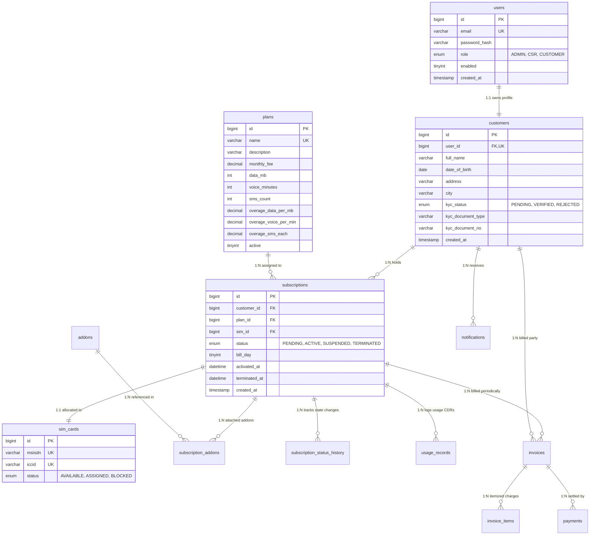

# Telecom BSS: Subscription Lifecycle & Billing Platform

Comprehensive architecture, domain model, lifecycle flows, database schema, and API specifications for a postpaid mobile telecommunications Business Support System (BSS).

**Stack**: Java 21, Spring Boot 3.2.0, Maven, MySQL 8.x, Flyway, JPA / Hibernate, Spring Security + JJWT 0.12.3, Lombok, SpringDoc OpenAPI.

---

## 1. Architecture Overview

### Modular Monolith First
The platform is built as a **modular monolith** with clean, decoupled domain packages designed for straightforward future migration into independent microservices.

Root package: `com.yojit.bss`

```
com.yojit.bss
 ├── common        (Global exceptions, AOP logging aspect, utility config)
 ├── security      (Spring Security, JWT filter & provider, User entity, Role enum)
 ├── customer      (Customer profile, KYC status & verification)
 ├── catalog       (Rate plans, Add-on packs)
 ├── sim           (SIM card inventory, status tracking, availability queries)
 ├── subscription  (Subscription lifecycle state machine, atomic provisioning)
 ├── usage         (Voice / SMS / Data rating and CDR ingestion - planned)
 ├── billing       (Billing cycle job, invoices, invoice line items - planned)
 ├── payment       (Payment processing, transaction auditing - planned)
 └── notification  (Email / SMS notifications - planned)
```

Each module is structured internally into clear architectural layers:
`controller / service / repository / entity / dto`

### Architectural & Module Boundary Rules
1. **Domain Encapsulation**: A module owns its domain tables and repositories. External callers interact through clean service interfaces or REST endpoints.
2. **Decoupled Entity References**: Across modules, references use primary keys (e.g., `customerId`, `planId`, `simId`) or bounded JPA associations where transactional atomicity is required (such as `Subscription` provisioning).
3. **Data Transfer Objects (DTOs)**: Entities are never exposed directly through controllers. All incoming requests and outgoing responses use dedicated DTO contracts.
4. **Declarative Validation & Exceptions**: Controller requests are validated using Jakarta Bean Validation (`@Valid`, `@NotNull`, `@NotBlank`, `@Size`). Exceptions are handled centrally via `@RestControllerAdvice`.
5. **Cross-Cutting Concerns via AOP**: Method execution, duration, and failures across service layers are automatically intercepted and logged by `LoggingAspect`.

---

## 2. Core Business Flow & State Machine

1. **User Registration & Authentication**: Customer creates an account (`POST /api/auth/register`), logs in (`POST /api/auth/login`), and receives a stateless JWT token.
2. **KYC & Customer Onboarding**: Authenticated user submits personal details and KYC document info (`POST /api/customers/me`). The customer record is initialized in `PENDING` KYC status.
3. **SIM Inventory Management**: Telco inventory administrators provision SIM cards (`POST /api/sims`) into inventory with status `AVAILABLE`.
4. **Subscription Provisioning & Activation**: Authenticated customer chooses a catalog `Plan` and an available `SimCard` (`POST /api/subscriptions`). The system executes an atomic transaction:
   - Validates SIM availability (`AVAILABLE`).
   - Transitions SIM status: `AVAILABLE` -> `ASSIGNED`.
   - Provisions `Subscription` in `ACTIVE` state with dynamic `bill_day` calculation and activation timestamp.
5. **Usage Simulation & Rating** *(Upcoming)*: Voice call minutes, SMS counts, and data MBs are ingested and recorded in `usage_records`.
6. **Monthly Billing Cycle** *(Upcoming)*: Scheduled billing job runs for accounts matching today's `bill_day`, calculating plan fee + active add-ons + overages + 18% GST into idempotent invoices.
7. **Payment & Dunning** *(Upcoming)*: Invoices paid via UPI/Card transition to `PAID`. Overdue invoices trigger dunning and subscription suspension (`SUSPENDED`).

---

## 3. Day 3: SIM Cards & Subscriptions Core

### 3.1 `com.yojit.bss.sim` Module
Manages physical SIM card and eSIM stock, lifecycle status, and inventory lookup.

- **Entity: `SimCard` (`sim_cards` table)**:
  - `id`: `BIGINT` auto-increment primary key.
  - `msisdn`: `VARCHAR(15)` unique phone number (Mobile Station International Subscriber Directory Number).
  - `iccid`: `VARCHAR(22)` unique SIM serial identifier (Integrated Circuit Card ID).
  - `status`: Mapped to MySQL `ENUM('AVAILABLE', 'ASSIGNED', 'BLOCKED')` with explicit column definition, defaulting to `'AVAILABLE'`.
- **Repository (`SimCardRepository`)**:
  - `findFirstByStatus(String status)`: Fetches an available SIM for pool assignment.
  - `findByMsisdn(String msisdn)`, `findByIccid(String iccid)`: Lookup by identity attributes.
  - `existsByMsisdn(String msisdn)`, `existsByIccid(String iccid)`: Enforces pre-save uniqueness constraints.
- **Service (`SimCardService`)**:
  - `addSimCard(SimCardRequest)`: Validates MSISDN and ICCID uniqueness, persists new SIM with initial `AVAILABLE` status.
  - `getAllSimCards()`: Retrieves complete SIM inventory mapped to `SimCardResponse` DTOs.
- **Controller (`SimCardController`)**:
  - `POST /api/sims`: Adds a new SIM to inventory (`201 Created`).
  - `GET /api/sims`: Returns all SIM cards in inventory (`200 OK`).

### 3.2 `com.yojit.bss.subscription` Module
Coordinates telecommunication contracts connecting customer accounts, service plans, and allocated SIM inventory.

- **Entity: `Subscription` (`subscriptions` table)**:
  - `id`: `BIGINT` auto-increment primary key.
  - `customer`: `@ManyToOne(fetch = FetchType.LAZY)` relationship to `Customer` (`customer_id`, not null).
  - `plan`: `@ManyToOne(fetch = FetchType.LAZY)` relationship to `Plan` (`plan_id`, not null).
  - `simCard`: `@OneToOne(fetch = FetchType.LAZY)` relationship to `SimCard` (`sim_id`, not null).
  - `status`: Mapped to MySQL `ENUM('PENDING', 'ACTIVE', 'SUSPENDED', 'TERMINATED')` with initial state `'ACTIVE'` upon provisioning.
  - `billDay`: Mapped explicitly via `@Column(name = "bill_day", nullable = false, columnDefinition = "TINYINT")` representing the recurring billing cycle day (1-28).
  - `activatedAt`: `DATETIME` recording initial service activation timestamp.
  - `terminatedAt`: `DATETIME` recording contract termination (nullable).
  - `createdAt`: `TIMESTAMP` creation audit timestamp (read-only mapping).
- **Atomic Provisioning Workflow (`SubscriptionService.createSubscription`)**:
  - Enclosed in `@Transactional` to guarantee all-or-nothing execution across tables:
    1. **Customer Verification**: Resolves user from JWT identity (`userEmail`) and fetches customer profile via `CustomerRepository.findByUserEmail(userEmail)`. Throws `ResourceNotFoundException` if profile does not exist (KYC onboarding prerequisite).
    2. **Plan Validation**: Verifies plan existence via `PlanRepository.findById(planId)`.
    3. **SIM Availability Check**: Retrieves target SIM via `SimCardRepository.findById(simId)` and asserts `status == 'AVAILABLE'`. Throws `IllegalArgumentException` if SIM is already assigned or blocked.
    4. **SIM State Transition**: Mutates SIM status from `AVAILABLE` to `ASSIGNED` and saves to `sim_cards`.
    5. **Subscription Activation**: Initializes `Subscription` with:
       - Linked `customer`, `plan`, and `simCard`.
       - Status set to `ACTIVE`.
       - `billDay` set dynamically to `LocalDate.now().getDayOfMonth()`.
       - `activatedAt` set to `LocalDateTime.now()`.
    6. **Response Generation**: Maps saved entity to `SubscriptionResponse`.
- **Controllers (`SubscriptionController`)**:
  - `POST /api/subscriptions`: Creates and activates a new subscription for the logged-in customer (`201 Created`).
  - `GET /api/subscriptions/me`: Retrieves all active and historical subscriptions for the authenticated customer (`200 OK`).

---

## 4. Data Model & Entity Relationships

### 4.1 Cardinality & Association Summary
- `User` **1 : 1** `Customer`: Every registered user possesses at most one customer profile (`customers.user_id` is `UNIQUE`).
- `Customer` **1 : N** `Subscription`: A single customer can own multiple subscriptions/lines.
- `Plan` **1 : N** `Subscription`: A service plan can be subscribed to by multiple customer subscriptions.
- `Subscription` **1 : 1** `SimCard`: Each active subscription is uniquely linked to one SIM card (`sim_id` in `subscriptions`).

### 4.2 Mermaid Entity-Relationship Diagram



### 4.3 Known Schema Mapping Notes
- **`User.role`**: Defined in MySQL as `ENUM('ADMIN', 'CSR', 'CUSTOMER')`. Mapped in JPA using `@Enumerated(EnumType.STRING)` on the `Role` enum.
- **`Customer.kyc_status`**: Defined in MySQL as `ENUM('PENDING', 'VERIFIED', 'REJECTED')`. Mapped in JPA using `@Enumerated(EnumType.STRING)` on the `KycStatus` enum.
- **`Subscription.bill_day`**: Defined in MySQL as `TINYINT`. Mapped in `Subscription.java` using `@Column(name = "bill_day", nullable = false, columnDefinition = "TINYINT") private Integer billDay`.
  - *Rationale*: Hibernate schema validation (`ddl-auto=validate`) checks database metadata against Java types. Java `Integer` defaults to SQL `INTEGER/INT`. Without `columnDefinition = "TINYINT"`, validation fails on startup with `SchemaManagementException: wrong column type encountered in column [bill_day] ... found [tinyint], but expecting [integer]`. Explicit definition ensures strict compatibility.
- **`SimCard.status`**: Defined as MySQL `ENUM('AVAILABLE', 'ASSIGNED', 'BLOCKED')`. Mapped via `@Column(name = "status", columnDefinition = "ENUM('AVAILABLE', 'ASSIGNED', 'BLOCKED')")`.
- **`Subscription.status`**: Defined as MySQL `ENUM('PENDING', 'ACTIVE', 'SUSPENDED', 'TERMINATED')`. Mapped via `@Column(name = "status", columnDefinition = "ENUM('PENDING', 'ACTIVE', 'SUSPENDED', 'TERMINATED')")`.

---

## 5. Current API Directory (Days 1 - 3)

| Module | Method | Endpoint | Auth Required | Description |
|---|---|---|---|---|
| **Catalog** | `GET` | `/api/plans` | Public | List all active plans |
| **Catalog** | `GET` | `/api/plans/{id}` | Public | Get specific plan by ID |
| **Catalog** | `POST` | `/api/plans` | Bearer Token | Create new plan (admin) |
| **Auth** | `POST` | `/api/auth/register` | Public | Register new user account |
| **Auth** | `POST` | `/api/auth/login` | Public | Authenticate user & receive JWT token |
| **Customer** | `POST` | `/api/customers/me` | Bearer Token | Onboard customer profile & submit KYC |
| **Customer** | `GET` | `/api/customers/me` | Bearer Token | Fetch authenticated customer profile |
| **SIM** | `POST` | `/api/sims` | Bearer Token | Add new SIM card to inventory |
| **SIM** | `GET` | `/api/sims` | Bearer Token | List all SIM cards in inventory |
| **Subscription** | `POST` | `/api/subscriptions` | Bearer Token | Provision & activate a subscription |
| **Subscription** | `GET` | `/api/subscriptions/me` | Bearer Token | List subscriptions for current customer |

---

## 6. Key Decisions & Rationale

| Decision | Rationale |
|---|---|
| **Modular Monolith Architecture** | Eliminates distributed systems overhead while building domain models; packages preserve boundary clarity for subsequent service separation. |
| **Flyway Schema Migrations** | Provides deterministic, version-controlled schema evolution; prevents runtime schema discrepancies across environments. |
| **`ddl-auto=validate`** | Guarantees JPA entities exactly mirror production database tables without letting Hibernate generate unexpected schema alterations. |
| **`columnDefinition = "TINYINT"`** | Bridges Java `Integer` to MySQL `TINYINT` without failing Hibernate validation or requiring cumbersome Java `Byte` primitive types. |
| **Atomic Provisioning in `@Transactional`** | Guarantees SIM status transition to `ASSIGNED` and Subscription creation commit together or roll back cleanly, eliminating orphaned SIM assignments. |
| **Stateless JWT Security** | Enables horizontal scaling without server-side session replication; user context extracted reliably via `@AuthenticationPrincipal`. |
| **DTO-First API Contracts** | Prevents internal database structure leaks, avoids JPA lazy loading serialization bugs, and maintains strict versioned API boundaries. |
| **`BigDecimal` for Currency** | Avoids IEEE 754 floating-point rounding inaccuracies in financial pricing, tax computations, and billing. |

---

## 7. Technical Interview Q&A

**Q: How do you guarantee atomicity when activating a subscription and assigning a SIM card?**
A: `SubscriptionService.createSubscription` is annotated with `@Transactional`. The retrieval of the SIM, validation of its `AVAILABLE` status, update to `ASSIGNED`, and insertion of the `Subscription` entity occur within a single database transaction. If any step fails (e.g., database constraint violation, missing plan, or concurrent assignment), the entire transaction rolls back, preventing SIM inventory inconsistency.

**Q: Why was `@Column(columnDefinition = "TINYINT")` required for `bill_day`?**
A: With `spring.jpa.hibernate.ddl-auto=validate`, Hibernate compares the entity metadata with the database schema generated by Flyway. Java `Integer` maps to SQL standard `INTEGER` by default. Because the MySQL schema specifies `TINYINT` (valid day range 1-28), Hibernate throws a `SchemaManagementException`. Explicitly declaring `columnDefinition = "TINYINT"` informs Hibernate that the column is intentionally stored as a `TINYINT`.

**Q: How does the system prevent multiple subscriptions from claiming the same SIM card?**
A: First, at the business logic level, `createSubscription` checks that `simCard.getStatus().equals("AVAILABLE")`. Second, at the database level, `sim_cards.msisdn` and `sim_cards.iccid` have unique constraints, and `subscriptions.sim_id` enforces a one-to-one relationship with foreign key integrity.

**Q: How is authentication handled for protected endpoints like `/api/subscriptions`?**
A: Requests pass through `JwtAuthenticationFilter`, which parses the `Authorization: Bearer <token>` header, validates the signature and expiration using `JwtService`, loads the `UserDetails` (`User`), and sets the `SecurityContextHolder`. Controllers access the authenticated user via `@AuthenticationPrincipal UserDetails userDetails`.
